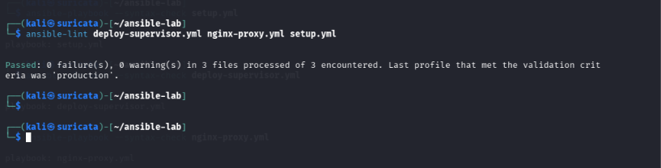

# Infrastructure Automation Lab with Ansible

## Project Overview

A hands-on infrastructure automation project using Ansible, Docker, Ubuntu, Node.js, Supervisor, and Nginx.

The project automates application deployment, manages application processes, and routes HTTP requests through an Nginx reverse proxy.

## Architecture

- **Control Node:** Kali Linux with Ansible
- **Managed Hosts:** Three Ubuntu-based Docker containers
- **Application Servers:** Two Node.js applications managed by Supervisor
- **Reverse Proxy:** Nginx
- **Connectivity:** SSH and a dedicated Docker bridge network

## Technology Stack

- Ansible — configuration management and deployment
- Docker — isolated lab environments
- Ubuntu 24.04 — container operating system
- Node.js and Express — web applications
- Supervisor — process management and automatic application restart
- Nginx — HTTP reverse proxy

## Implemented Features

- SSH connectivity to multiple managed hosts
- Automated installation of application dependencies
- Repeatable application deployment with Ansible
- Supervisor configuration for Node.js services
- Nginx reverse proxy routing
- HTTP health endpoint
- Application connectivity and service-status checks
- Idempotency testing with zero changes on a repeated deployment run

## HTTP Routes

| Endpoint | Destination | Expected Response |
|---|---|---|
| `/ansible` | app-server1 | Hello from App Server 1! |
| `/puppet` | app-server2 | Hello from App Server 2! |
| `/health` | Nginx | Nginx reverse proxy is healthy |

## Main Project Files

- `ansible.cfg` — Ansible configuration
- `inventory` — managed hosts and SSH settings
- `Dockerfile` — lab container image
- `setup.yml` — Node.js setup
- `deploy-supervisor.yml` — application deployment and process management
- `nginx-proxy.yml` — reverse proxy configuration
- `files/appserver1/` — first application source
- `files/appserver2/` — second application source

## Validation Commands

Check connectivity:

`ansible all -m ping`

Check playbook syntax:

`ansible-playbook deploy-supervisor.yml --syntax-check`

Deploy the applications:

`ansible-playbook deploy-supervisor.yml`

Configure Nginx:

`ansible-playbook nginx-proxy.yml`

Check application status:

`ansible app_servers -m command -a "supervisorctl status myapp"`

Test the reverse proxy:

`ansible nginx-server -m command -a "curl -fsS http://127.0.0.1/health"`

`ansible nginx-server -m command -a "curl -fsS http://127.0.0.1/ansible"`

`ansible nginx-server -m command -a "curl -fsS http://127.0.0.1/puppet"`

## Security Notes

This is a local learning environment, not a production deployment.

- Never commit private SSH keys or secrets.
- Use least-privilege accounts in production.
- Restrict network access and harden container configurations.
- Use centralized logging and monitoring for production services.

## Future Improvements

- Refactor playbooks into reusable Ansible roles
- Add GitHub Actions for linting and syntax validation
- Add more comprehensive health checks
- Integrate monitoring and alerting

## Skills Demonstrated

Linux administration, Docker networking, SSH, Ansible automation, YAML, application deployment, process supervision, Nginx reverse proxy, troubleshooting, and service validation.

## Project Validation & Evidence

The project was validated using Ansible, Ansible Lint, and GitHub Actions.

### Validation Results
- GitHub Actions CI workflow passed.
- Ansible Lint passed with the production profile.
- Ansible connectivity verified for all three managed containers.
- Both Node.js applications returned successful HTTP responses.
- Nginx configuration validation passed.
- Nginx reverse proxy successfully routed requests to both application servers.

### Screenshots

#### 1. GitHub Actions CI Pipeline — Successful Run

#### 2. Ansible Lint

#### 3. Ansible Connectivity

#### 4. Application Server Tests

#### 5. Nginx Reverse Proxy

